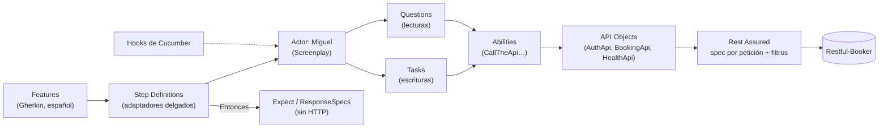

# Restful-Booker API Automation

[](https://github.com/miguel-robayo/restful-booker-api-automation/actions/workflows/ci.yml)

Framework de automatización de la API REST pública [Restful-Booker](https://restful-booker.herokuapp.com/apidoc/index.html), construido con **Java 21, Maven, Rest Assured 5, Cucumber 7 (Gherkin en español), Screenplay propio, API Objects y Allure 2**.

Cubre los **cinco escenarios** del documento de la prueba técnica (11 escenarios de Cucumber) y **93 tests técnicos** del propio framework (JUnit 5, sin red).

| | |
|---|---|
| Estado | ✅ 104/104 tests en verde contra la API real (`-Denv=qa`, 2026-11-05) · [evidencias](docs/delivery/execution-evidence.md) |
| Escenarios | [Documentación de los cinco escenarios](docs/delivery/scenarios.md) |
| CI | [Pipeline de GitHub Actions](docs/delivery/ci-pipeline.md) |

---

## Índice

1. [Stack](#1-stack)
2. [Arquitectura](#2-arquitectura)
3. [Instalación](#3-instalación)
4. [Configuración de Java 21 y Maven](#4-configuración-de-java-21-y-maven)
5. [Credenciales](#5-credenciales)
6. [Configuración de ambientes](#6-configuración-de-ambientes)
7. [Comandos de ejecución](#7-comandos-de-ejecución)
8. [Reportes Allure](#8-reportes-allure)
9. [Los cinco escenarios](#9-los-cinco-escenarios)
10. [Pipeline de GitHub Actions](#10-pipeline-de-github-actions)
11. [Evidencias de ejecución](#11-evidencias-de-ejecución)
12. [Solución de problemas](#12-solución-de-problemas)
13. [Documentación](#13-documentación)

---

## 1. Stack

| Componente | Versión | Uso |
|---|---|---|
| Java (JDK) | **21** (exigido por Maven Enforcer) | Lenguaje |
| Maven | ≥ 3.9 · Wrapper incluido (3.9.14) | Build |
| Rest Assured · json-schema-validator | 5.5.7 | HTTP y contrato |
| Cucumber (`cucumber-java`, `junit-platform-engine`, `picocontainer`) | 7.34.9 | BDD sobre JUnit Platform, un contexto por escenario |
| JUnit 5 | 5.14.4 | Runner `@Suite` y tests técnicos |
| Jackson · Lombok · Datafaker | 2.22.4 · 1.18.48 · 2.7.0 | Modelos con `@Builder` y datos dinámicos |
| Allure (`allure-cucumber7-jvm`, `allure-maven`) | 2.35.5 · plugin 3.1.0 · CLI 2.46.1 | Reportes |

## 2. Arquitectura



**Reglas principales** (verificadas por `ArchitectureRulesTest` y `FeatureConventionsTest`):

- **Dado** prepara el contexto · **Cuando** ejecuta *exactamente una* acción · una **observación posterior** (`@AfterStep`) lee la evidencia que el `Cuando` declaró · **Entonces** valida la evidencia almacenada **sin hacer HTTP**.
- Solo los API Objects construyen peticiones. Nunca se escribe en `RestAssured.*` estático y se crea una spec nueva por petición, lo que permite ejecutar en paralelo de forma segura (4 hilos).
- Features en lenguaje de negocio: sin términos técnicos ni códigos HTTP.
- Secretos enmascarados en logs y adjuntos (`password`, `token`, `Cookie`, `Authorization` → `***`).
- Cada escenario crea sus propios datos y, en `@After`, los limpia después de comprobar que le pertenecen.

```
src/main/java/com/credibanco/qa/restfulbooker/
├── config/       Configuración por ambiente con fail-fast
├── http/         SpecFactory, filtros (token, enmascarado, Allure), JsonMapper
├── api/          API Objects: AuthApi, BookingApi, HealthApi
├── model/        DTOs con Lombok @Builder
├── data/         BookingDataFactory (Datafaker)
├── screenplay/   core · abilities · tasks · questions
├── reporting/    AllureReporter
└── support/      Limpieza, health check, consolidación
src/test/java/com/credibanco/qa/restfulbooker/
├── runners/      ApiScenariosSuite (todos los features) · BookingCreationTests (escenario 2)
├── steps/ hooks/ context/ support/
└── framework/    Tests técnicos (FW-01, FW-02, reglas de arquitectura y de BDD)
src/test/resources/
├── features/     authentication · booking_creation · booking_queries · booking_validation
├── config/       default · dev · qa (.properties)
├── schemas/      booking.json
└── allure/       categories.json
```

Detalle completo, con las capas, el ciclo de ejecución y las ADR-01 a ADR-24: [`docs/architecture/framework-architecture.md`](docs/architecture/framework-architecture.md).

## 3. Instalación

```bash
git clone https://github.com/miguel-robayo/restful-booker-api-automation.git
cd restful-booker-api-automation
```

1. Instala un **JDK 21** y configura `JAVA_HOME` ([sección 4](#4-configuración-de-java-21-y-maven)).
2. Define las credenciales como variables de entorno ([sección 5](#5-credenciales)).
3. Verifica el entorno sin llamar a la API:

   ```bash
   ./mvnw -v                                                  # debe mostrar Java version: 21.x
   ./mvnw test -Dtest=ApiScenariosSuite -Dcucumber.execution.dry-run=true
   ```

No hace falta instalar Maven: el Wrapper lo descarga la primera vez.

## 4. Configuración de Java 21 y Maven

El build **falla** con cualquier versión distinta de Java 21: `maven-enforcer-plugin` exige `[21,22)` y Maven ≥ 3.9.

**Windows (PowerShell)**

```powershell
winget install EclipseAdoptium.Temurin.21.JDK
# Ajusta la ruta a la versión instalada
[Environment]::SetEnvironmentVariable("JAVA_HOME", "C:\Program Files\Eclipse Adoptium\jdk-21.0.13.9-hotspot", "User")
# Abre una terminal nueva y comprueba
java -version
.\mvnw.cmd -v
```

**Linux / macOS**

```bash
sdk install java 21-tem          # SDKMAN!  (o: brew install --cask temurin@21)
export JAVA_HOME="$(sdk home java 21-tem)"
java -version && ./mvnw -v
```

**Maven:** puedes usar el Wrapper (`./mvnw`, o `mvnw.cmd` en Windows), que es lo recomendado y lo que usa CI, o un Maven ≥ 3.9 instalado (`mvn`). Ambos son equivalentes: los comandos de este README valen con `mvn` o con `./mvnw`.

> Si tienes varios JDK, Maven usa el de `JAVA_HOME`, no el primero del `PATH`. Revisa la línea `Java version` de `mvn -v`.

## 5. Credenciales

Las credenciales **nunca** se guardan en el repositorio. Se resuelven solo desde:

| Fuente | Usuario | Contraseña |
|---|---|---|
| Variables de entorno (recomendado) | `RB_USERNAME` | `RB_PASSWORD` |
| Propiedades de sistema (puntual) | `-Dauth.username=…` | `-Dauth.password=…` |
| CI | GitHub Secret `RB_USERNAME` | GitHub Secret `RB_PASSWORD` |

```powershell
# Windows, solo para la sesión actual
$env:RB_USERNAME = "<usuario>"; $env:RB_PASSWORD = "<contraseña>"
```

```bash
# Linux / macOS
export RB_USERNAME='<usuario>' RB_PASSWORD='<contraseña>'
```

Usa las credenciales que indica el documento de la prueba. Se validan en el primer uso: si faltan, el escenario termina como *broken* con un mensaje que nombra la variable. `.gitignore` excluye `.env` y `*.local.properties`.

## 6. Configuración de ambientes

El ambiente se elige con `-Denv=<nombre>` (`qa` por defecto). Los ambientes válidos están en la clave `environments` de `default.properties`; un ambiente desconocido detiene la ejecución con un error descriptivo.

| Ambiente | Archivo | `base.url` |
|---|---|---|
| `qa` (por defecto) | `src/test/resources/config/qa.properties` | `https://restful-booker.herokuapp.com` |
| `dev` | `src/test/resources/config/dev.properties` | `https://restful-booker.herokuapp.com` |

Solo existe la API pública, así que los dos ambientes apuntan a la misma URL (decisión D-14).

**Precedencia** (de mayor a menor): `-Dclave` > variable de entorno `RB_CLAVE` > `config/<env>.properties` > `config/default.properties`. Nombre de la variable: `base.url` → `RB_BASE_URL`.

| Clave | Valor por defecto | Significado |
|---|---|---|
| `base.url` | por ambiente | URL de la API; debe ser `https://` |
| `auth.username` / `auth.password` | `${RB_USERNAME}` / `${RB_PASSWORD}` | Credenciales (solo desde el entorno) |
| `sla.booking.get.ms` | `2000` | Tiempo máximo de `GET /booking/{id}` (escenario 4) |
| `query.price.threshold` | `500` | Valor de referencia del filtro GPath (escenario 3) |
| `notfound.booking.id` | `9999999` | ID inexistente (escenario 5) |
| `http.timeout.ms` | `10000` | Timeout de conexión y lectura |

**Agregar un ambiente:** crea `config/<nombre>.properties` con su `base.url` y añade el nombre a `environments` en `default.properties`.

```bash
mvn clean test -Denv=dev -Dsla.booking.get.ms=3000     # ejemplo de override puntual
```

## 7. Comandos de ejecución

Requieren JDK 21 y, salvo el dry-run y los tests técnicos, `RB_USERNAME`/`RB_PASSWORD`.

| Objetivo | Comando |
|---|---|
| **Suite completa en QA** (tests técnicos y los 11 escenarios, sin `@known-defect`) | `mvn clean test -Denv=qa` |
| **Solo el escenario 2, creación de reservas** | `mvn test -Dtest=BookingCreationTests -Denv=qa` |
| **Abrir el reporte Allure** | `mvn allure:serve` |
| Comando del pipeline (igual que el anterior, más la fase `verify`) | `./mvnw clean verify -Denv=qa` |
| Otro ambiente | `mvn clean test -Denv=dev` |
| Un escenario por etiqueta | `mvn test -Dtest=ApiScenariosSuite "-Dcucumber.filter.tags=@TC-NEG-01" -Denv=qa` |
| Uno de los cinco escenarios | `mvn test -Dtest=ApiScenariosSuite "-Dcucumber.filter.tags=@esc-3" -Denv=qa` |
| Solo los escenarios Cucumber | `mvn test -Dtest=ApiScenariosSuite -Denv=qa` |
| Solo una clase de tests técnicos (sin red) | `mvn test -Dtest=ConfigResolverTest` |
| Comprobar pasos sin llamar a la API | `mvn test -Dtest=ApiScenariosSuite -Dcucumber.execution.dry-run=true` |
| Job de defectos conocidos (resultados aparte) | `mvn clean test -Pknown-defects -Denv=qa` |

En PowerShell, deja entre comillas los argumentos que contienen `@` o `=`, como en los ejemplos. En Windows, `mvnw.cmd` reemplaza a `./mvnw`.

**`BookingCreationTests`** es un runner de Cucumber limitado a `features/booking_creation.feature`. Su nombre no coincide con los patrones de Surefire (`*Test`, `*Suite`), así que la suite completa no ejecuta ese escenario dos veces; solo se ejecuta cuando lo pides con `-Dtest`.

**Etiquetas útiles:** `@esc-1` … `@esc-5` (escenario del documento), `@TC-xx` (caso de prueba), `@negative`, `@security`, `@contract`, `@performance`, `@auth`, `@booking`, `@query`, `@validation`.

## 8. Reportes Allure

Cada ejecución escribe los resultados en `target/allure-results` (job de defectos conocidos: `target/allure-results-known-defects`). No hace falta instalar Allure: el plugin descarga la CLI 2.46.1, que es Java y no necesita Node.js.

| Acción | Comando | Salida |
|---|---|---|
| Ver el reporte en el navegador (servidor local temporal) | `mvn allure:serve` | `http://127.0.0.1:<puerto>` |
| Generar el reporte estático | `mvn allure:report` | `target/site/allure-maven-plugin/index.html` |
| Reporte del job de defectos conocidos | `mvn allure:serve -Pknown-defects` | |

**Contenido del reporte:**

- Pasos Gherkin con las Tasks y Questions anidadas.
- Request y response enmascarados como adjuntos.
- Semilla de datos, medición del SLA y limpieza de las reservas creadas.
- Etiquetas `@TC-xx`/`@esc-N` y enlaces `@issue=KD-xx` hacia [`known-defects.md`](docs/known-defects.md).
- Panel *Environment* con `cleanup.pending.count`.

**Categorías:** clasifican cada fallo según el prefijo del mensaje de la aserción.

| Categoría | Estado | Cuándo |
|---|---|---|
| Product Defect | failed | Requisito funcional incumplido |
| Performance (SLA) | failed | Mensaje `SLA:` |
| Known Defect | failed | Mensaje `KD-xx:` (defecto registrado) |
| Precondition | broken | Mensaje `PRECONDITION:` (no se pudo preparar el escenario) |
| Infrastructure | broken | Mensaje `INFRA:` o error de red, DNS, TLS o timeout |
| Test Defect | broken | Error del framework |

Los tests técnicos (FW) se reportan en `target/surefire-reports`, no en Allure (ADR-16).

## 9. Los cinco escenarios

| # | Escenario del documento | Feature | Casos | Etiqueta |
|---|---|---|---|---|
| 1 | Autenticación y reutilización del token en `PUT`/`DELETE` | `authentication.feature` | TC-AUTH-01, TC-AUTH-02 (2 escenarios) | `@esc-1` |
| 2 | Creación dinámica con Builder y datos generados | `booking_creation.feature` | TC-CRE-01 | `@esc-2` |
| 3 | Búsqueda por nombre y filtro GPath por precio | `booking_queries.feature` | TC-QRY-01 | `@esc-3` |
| 4 | Contrato (JSON Schema), SLA y headers | `booking_validation.feature` | TC-CON-01, TC-CON-02, TC-CON-03 | `@esc-4` |
| 5 | Casos negativos: sin token, token inválido, ID inexistente | `authentication.feature`, `booking_queries.feature` | TC-NEG-01, TC-NEG-02, TC-NEG-03 | `@esc-5` |

Objetivo, pasos, resultado esperado, requisitos y comando de cada uno: [`docs/delivery/scenarios.md`](docs/delivery/scenarios.md).

## 10. Pipeline de GitHub Actions

Archivo: [`.github/workflows/ci.yml`](.github/workflows/ci.yml). Se ejecuta con `push` a `main`, `feature/**` y `fix/**`, con `pull_request` a `main` y manualmente (`workflow_dispatch`, eligiendo `qa` o `dev`).

| Job | Qué hace | Bloquea |
|---|---|---|
| `main` | Java 21 (Temurin) con caché de Maven → valida los secretos → `./mvnw clean verify -Denv=qa` → `allure:report` → resumen en la página del run → artifacts | **Sí** |
| `known-defects` | Igual, con `-Pknown-defects` | No (`continue-on-error`): conserva su resultado real |

**Configuración previa:** en *Settings → Secrets and variables → Actions*, crea los secretos `RB_USERNAME` y `RB_PASSWORD`.

**Artifacts** (30 días): `evidence-main-<env>-<run>` y `evidence-known-defects-<env>-<run>`, con `allure-results`, el reporte HTML, `surefire-reports` y `cleanup/`.

Para ver el reporte de un run, descarga el artifact y ejecuta `allure open target/site/allure-maven-plugin`. Otra opción: copia `allure-results` a `target/` y ejecuta `mvn allure:serve`.

Detalle del diseño, el manejo de errores y los secretos: [`docs/delivery/ci-pipeline.md`](docs/delivery/ci-pipeline.md).

## 11. Evidencias de ejecución

Ejecución real del 2026-11-05 con JDK 21.0.13 y Maven 3.9.14 contra la API pública:

| Comando | Resultado |
|---|---|
| `mvn clean test -Denv=qa` | ✅ `Tests run: 104, Failures: 0, Errors: 0, Skipped: 0` · BUILD SUCCESS |
| `mvn test -Dtest=BookingCreationTests -Denv=qa` | ✅ `Tests run: 1, Failures: 0` · BUILD SUCCESS |
| `mvn allure:report` / `mvn allure:serve` | ✅ 11 escenarios *passed* · servidor local iniciado |
| `./mvnw clean verify -Denv=qa` (comando del CI) | ✅ 104/104 · BUILD SUCCESS |
| Fallo forzado (`-Dsla.booking.get.ms=1`) | ✅ exit 1 · BUILD FAILURE · categoría *Performance (SLA)* |

Salidas, tabla por escenario, revisión de secretos y limitaciones: [`docs/delivery/execution-evidence.md`](docs/delivery/execution-evidence.md).

## 12. Solución de problemas

| Síntoma | Causa y solución |
|---|---|
| `Java 21 is required. Point JAVA_HOME to a JDK 21 installation.` | `JAVA_HOME` apunta a otro JDK. Corrígelo y revisa `mvn -v` |
| Escenarios *broken* que mencionan `RB_USERNAME`/`RB_PASSWORD` | Faltan las credenciales ([sección 5](#5-credenciales)) |
| Todo *broken* en la categoría Infrastructure | `GET /ping` falló: la API pública no está disponible o hay un problema de red. Reintenta más tarde |
| Fallo en *Performance (SLA)* | La API respondió en más de 2000 ms (*cold start* de Heroku o red). Se reporta sin reintentos, por diseño |
| Archivo `*.dumpstream` con *"'other' has different root"* (Windows) | El proyecto está en otra unidad que el directorio temporal. Es inofensivo |
| `Unknown environment` | El valor de `-Denv` no está en `environments` |

## 13. Documentación

| Documento | Contenido |
|---|---|
| [Análisis de requisitos](docs/analysis/requirements-analysis.md) | Requisitos RF/RC/RNF, hallazgos de la API y trazabilidad |
| [Estrategia de pruebas](docs/strategy/test-strategy.md) | 24 escenarios planificados, niveles REQ/MON, categorías, decisiones D-01 a D-22 |
| [Arquitectura](docs/architecture/framework-architecture.md) | Capas, regla Dado/Cuando/Entonces, ciclo de ejecución, ADR-01 a ADR-24 |
| [Defectos conocidos](docs/known-defects.md) | Divergencias de la API (KD-xx) y su tratamiento |
| [Los cinco escenarios](docs/delivery/scenarios.md) | Documentación funcional y técnica de cada escenario |
| [Pipeline CI](docs/delivery/ci-pipeline.md) | Diseño del workflow, secretos, artifacts y errores |
| [Evidencias](docs/delivery/execution-evidence.md) | Resultados de la ejecución real |
