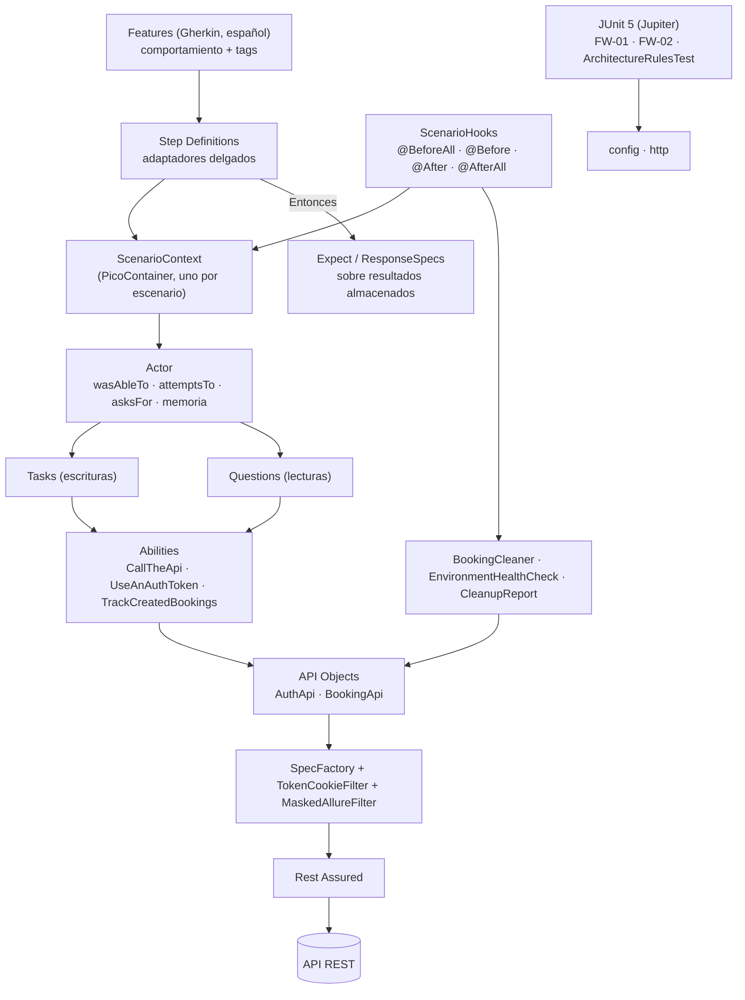

# Arquitectura del Framework — Restful-Booker API

**Versión 2.1 · 2026-11-05 · Aprobado** (v2.1: resultados de la verificación de la fase 0)
Estrategia: [`test-strategy.md`](../strategy/test-strategy.md) · Requisitos: [`requirements-analysis.md`](../analysis/requirements-analysis.md) · Defectos: [`known-defects.md`](../known-defects.md)

## 1. Capas y responsabilidades



| Capa | Responsabilidad | Prohibido |
|---|---|---|
| **Features** | Describir el comportamiento con `@TC-xx`, `@esc-N` y las etiquetas de nivel | Datos técnicos, URLs, JSON |
| **Step Definitions** | Traducir cada paso en **una** llamada al Actor o a `Expect` | HTTP, Rest Assured, API Objects, reglas de negocio |
| **ScenarioContext** | Contener el Actor del escenario (instancia nueva por escenario, **sin campos `static`**) | Estado compartido entre escenarios |
| **Actor** | Ejecutar Tasks y Questions, recordar resultados (`remember`/`recall`) y publicar los steps de Allure | Aserciones |
| **Abilities** | Entregar API Objects con la spec adecuada (base o autenticada) | Lógica de negocio |
| **Tasks** | Una escritura de negocio: guardan la `Response` y registran las reservas creadas | Aserciones, lecturas |
| **Questions** | Una lectura (HTTP o derivada, por ejemplo GPath) que devuelve un valor tipado | Escrituras, aserciones |
| **API Objects** | Endpoint, método, parámetros → `Response` sin validar | Aserciones, lógica |
| **http** | Spec inmutable, autenticación por filtro, enmascarado, adjuntos de Allure, logs `ifValidationFails` | Estado global de Rest Assured |
| **Expect / ResponseSpecs** | Aserciones reutilizables con prefijos `KD-xx:` y `SLA:` | Peticiones HTTP |
| **support** | Limpieza con verificación de propiedad, health check y consolidación de pendientes | Aserciones |

## 2. Regla Gherkin → Actor

| Paso | Llamada | Semántica |
|---|---|---|
| **Dado** | `actor.wasAbleTo(task…)` | Precondición. Exige una respuesta 2xx; si no la obtiene → `PreconditionFailedException` (categoría Precondition) |
| **Cuando** (escritura) | `actor.attemptsTo(task…)` | Acción bajo prueba. La Task guarda la `Response` y nunca valida |
| **Cuando** (consulta) | `actor.remember(clave, actor.asksFor(question))` | La lectura ocurre **aquí**, en el momento que el escenario expresa |
| **Entonces** | `Expect…(actor.recall(clave))` / `ResponseSpecs` | Verifica **resultados ya almacenados**. **Nunca provoca HTTP** |

Ejemplo (TC-NEG-01):
```gherkin
# language: es
@TC-NEG-01 @esc-5 @requested @req @security
Escenario: Actualizar una reserva sin token es rechazado
  Dado que el huésped tiene una reserva propia
  Cuando intenta actualizarla sin token de autenticación
  Y consulta nuevamente la reserva
  Entonces la actualización es rechazada con 403
  Y la reserva consultada no ha cambiado
```

## 3. Estructura

```
src/main/java/com/credibanco/qa/restfulbooker/
├── config/      EnvironmentConfig, ConfigResolver, ConfigurationException
├── http/        SpecFactory, JsonMapper, TokenCookieFilter, MaskedAllureFilter, SensitiveDataMasker
├── api/         AuthApi, BookingApi
├── model/       Booking, BookingDates, BookingResponse, AuthRequest, AuthResponse
├── data/        BookingDataFactory, UniqueMarker
├── screenplay/  core/ (Actor, Ability, Performable, Question, PreconditionFailedException)
│                abilities/ tasks/ questions/
└── support/     BookingCleaner, EnvironmentHealthCheck, CleanupReport, InfrastructureException

src/test/java/com/credibanco/qa/restfulbooker/
├── runners/     ApiScenariosSuite   (@Suite · @IncludeEngines("cucumber") · @SelectPackages("features"))
├── context/     ScenarioContext
├── hooks/       ScenarioHooks
├── steps/       AuthenticationSteps, BookingSteps, QuerySteps, ValidationSteps, LifecycleSteps
├── support/     Expect, ResponseSpecs, InvalidBookingPayload
└── framework/   ConfigResolverTest (FW-02), SensitiveDataMaskerTest (FW-01), ArchitectureRulesTest

src/test/resources/
├── features/    authentication · booking_creation · booking_queries · booking_validation · booking_lifecycle (.feature)
├── config/      default · dev · qa (.properties)
├── schemas/     booking.json, booking-response.json
├── allure/      categories.json
└── allure.properties, junit-platform.properties
```

## 4. Dependencias

| Dependencia | Versión | Fase | Motivo |
|---|---|---|---|
| `junit-bom` → `junit-jupiter`, `junit-platform-suite` | 5.14.4 | 0 | Tests técnicos + runner `@Suite` para Cucumber |
| `cucumber-bom` → `cucumber-java`, `cucumber-junit-platform-engine`, `cucumber-picocontainer` | 7.34.9 | 0 | BDD sobre JUnit Platform; contexto por escenario |
| `allure-bom` → `allure-cucumber7-jvm` | 2.35.5 | 0 | **Único** adaptador de Allure |
| `rest-assured`, `json-schema-validator` | 5.5.7 | 1 | HTTP y contrato |
| `jackson-databind`, `jackson-datatype-jsr310`, `lombok` (`provided`), `datafaker` | Se fijan en la fase 1 (con al menos 2 semanas de publicadas) | 1 | Modelos y datos |
| **Plugins:** compiler 3.16.0 · surefire 3.6.0 · resources 3.5.0 · clean 3.5.0 · enforcer 3.6.3 · allure-maven 3.1.0 · Maven Wrapper (Maven 3.9.14) | | 0 | Build reproducible |

**Excluidas a propósito:** `allure-junit5` (duplicaría los escenarios), `aspectjweaver` (ADR-06), `allure-rest-assured` (ADR-05) y cualquier librería de logging (ADR-07).

## 5. Ciclo de ejecución

| Momento | Qué ocurre |
|---|---|
| `mvn clean test` | Surefire ejecuta los tests técnicos de Jupiter (FW) y `ApiScenariosSuite` con `cucumber.filter.tags = not @known-defect`. Resultados en `target/allure-results` y `target/surefire-reports` |
| `mvn test -Pknown-defects` | **Solo** `ApiScenariosSuite`, con `@known-defect`; sin FW-01 ni FW-02. Resultados en `target/allure-results-known-defects` y `target/surefire-reports-known-defects`. Se conserva el resultado real (sin `testFailureIgnore`) |
| `@BeforeAll` (una vez) | `EnvironmentHealthCheck` → `GET /ping`; si falla → `InfrastructureException` (`INFRA:`) |
| Por escenario | PicoContainer crea `ScenarioContext` → `@Before` crea el Actor (abilities, semilla) → pasos → `@After` (siempre): `BookingCleaner` hace un `GET` de propiedad y un `DELETE` solo si es propia (D-12) |
| Pendientes de limpieza | Cada escenario escribe **su propio** archivo en `target/cleanup/` (nombre único): sin estado compartido en memoria |
| `@AfterAll` | `CleanupReport` consolida `target/cleanup/` → `cleanup-pending.json`, panel Environment de Allure y resumen en consola |
| Paralelismo | `cucumber.execution.parallel.enabled=true`, `fixed`, 4 hilos (configurable). Un escenario se ejecuta entero en un hilo con su propio contexto |

## 6. Configuración, autenticación, datos, errores y logs

| Tema | Diseño |
|---|---|
| Configuración | Precedencia `-D` > `RB_*` > `<env>.properties` > `default.properties`; `-Denv=dev\|qa`; URL `https` validada al cargar; credenciales `${RB_USERNAME}`/`${RB_PASSWORD}` validadas **al primer uso** |
| Autenticación | Task `Authenticate` → token en `UseAnAuthToken` (exige `token`; un 200 con `reason` falla, KD-01). `CallTheApi` usa `SpecFactory.authenticated(token)` (spec nueva + `TokenCookieFilter`). La limpieza usa su propio actor |
| Datos | `BookingDataFactory` (Datafaker, semilla por escenario); `firstname` único; serialización `NON_NULL`; `InvalidBookingPayload` solo en `src/test` |
| Excepciones (unchecked) | `AssertionError` → failed · `PreconditionFailedException` / `InfrastructureException` / otras → broken. `ConfigurationException` → Test Defect. Nadie silencia excepciones |
| Logs | Request/response enmascarados como adjuntos de Allure del paso · `log().ifValidationFails()` por spec, con `Cookie`/`Authorization` en lista negra · `System.Logger` del JDK para el framework |
| Paralelismo seguro | Sin escrituras en `RestAssured.*`; specs inmutables; actor, `Faker` y tracker por escenario. Compartidos e inmutables: `EnvironmentConfig`, `JsonMapper` |

## 7. Decisiones de arquitectura (ADR)

| ADR | Decisión | Trade-off |
|---|---|---|
| 01 | Screenplay **propio** y ligero, no Serenity | Control y pocas dependencias, a cambio de mantener unas 6 clases núcleo |
| 02 | **Sin Interactions HTTP** y **sin HTTP en los steps**: solo los API Objects hablan HTTP | Elimina la capa duplicada |
| 03 | Escrituras = Tasks, lecturas = Questions; las Questions se ejecutan en el paso que expresa la lectura y su resultado se almacena | Un solo camino por operación; los `Entonces` son puros |
| 04 | Los API Objects devuelven `Response` sin validar | Los negativos necesitan la respuesta cruda |
| 05 | `MaskedAllureFilter` propio sobre `allure-java-commons` | Enmascara secretos (FW-01); se pierden las plantillas HTML de `allure-rest-assured` |
| 06 | `Allure.step(lambda)` anidado en los pasos Gherkin | Sin AspectJ; algo más explícito |
| 07 | `System.Logger` del JDK | Cero dependencias; menos configurable |
| 08 | DTOs con Lombok `@Value @Builder @Jacksonized` | Cumple el requisito de Builder; los *records* no tienen builder |
| 09 | Jackson tolerante (`FAIL_ON_UNKNOWN_PROPERTIES=false`) + `NON_NULL` | El contrato lo valida el JSON Schema (D-15) |
| 10 | `LocalDate` + `jackson-datatype-jsr310` | Fechas seguras a cambio de un módulo más |
| 11 | Framework en `src/main`, escenarios y tests técnicos en `src/test` | Capas separadas; dependencias en scope `compile` |
| **12** | **Reemplazado:** el ciclo de vida de los escenarios lo dan **solo** los hooks de Cucumber + `ScenarioContext`. Se eliminan las extensiones JUnit de la versión 1.0 | Un único mecanismo; los tests técnicos de Jupiter no usan Actor |
| **13** | Dado = `wasAbleTo` · Cuando = `attemptsTo` (escritura) o `asksFor` (consulta) · Entonces = `Expect` sobre lo almacenado | D-09 aplicado con una regla genérica; ningún `Entonces` hace HTTP oculto |
| 14 | Cucumber **7.34.9**, no 8 (este último está compilado contra JUnit 6) | Compatible con JUnit 5.14 y Allure 2.35; migrar a 8 implica JUnit 6 + Allure 3 |
| 15 | PicoContainer para el contexto por escenario | Ligero y propio de Cucumber; descartados un `ThreadLocal` manual (frágil) y Spring (pesado) |
| 16 | Un solo adaptador de Allure (`allure-cucumber7-jvm`); FW-01/02 se reportan solo en Surefire | Imposible duplicar; los tests técnicos no aparecen en Allure |
| 17 | Jobs separados por `cucumber.filter.tags` y perfil `known-defects` limitado a la suite, con directorios propios | Filtrado nativo de Cucumber, independiente de `groups` de Surefire |
| 18 | Maven Wrapper (Maven 3.9.14) | Build reproducible para evaluadores y CI; 3 archivos más |
| 19 | Gherkin en español (`# language: es`), código en inglés | Legible para la exposición; dos idiomas en el repositorio |

## 8. Verificación de la fase 0 (ejecución real con escenarios de prueba, sin HTTP)

| Verificado | Resultado |
|---|---|
| `allure-cucumber7-jvm 2.35.5` + Cucumber 7.34.9 | ✅ Compatibles; `allure-maven 3.1.0` genera el reporte con la herramienta Java 2.46.1 (no Node.js) |
| Un resultado de Allure por escenario | ✅ 12 resultados para 12 escenarios; FW no aparece en Allure |
| Filtrado por etiquetas a través de `@Suite` | ✅ `not @known-defect` en el principal; `-Pknown-defects` ejecuta solo `@known-defect`, sin FW y con directorios propios |
| Paralelismo y aislamiento | ✅ 4 hilos, un `ScenarioContext` distinto por escenario, `@BeforeAll` una sola vez, `@After` tras un paso fallido |
| Estados y categorías | ✅ failed/broken correctos; cada escenario en una sola categoría. Con cinco categorías, el SLA caía en la categoría interna "Product defects" de Allure → se agregó **Performance (SLA)** |
| `@issue=KD-xx` | ✅ Enlace de tipo *issue*; navega a `known-defects.md` gracias a `allure.link.issue.pattern` |
| Selector de features | `@SelectClasspathResource` genera un aviso de Cucumber → se usa `@SelectPackages("features")` |

**Pendiente (fase 1):** consolidación concurrente de `target/cleanup/` con el `CleanupReport` real, step broken dentro de un escenario aprobado y panel Environment.
