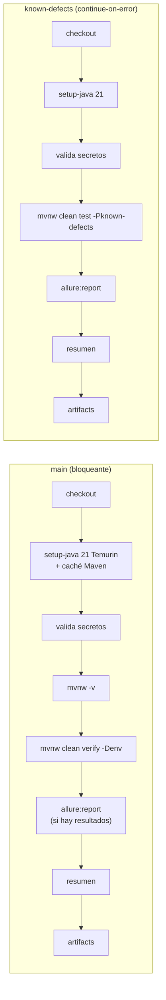

# Pipeline de integración continua — GitHub Actions

**Entrega técnica · 2026-11-05** · Workflow: [`.github/workflows/ci.yml`](../../.github/workflows/ci.yml) · Resumen: [`.github/scripts/test-summary.sh`](../../.github/scripts/test-summary.sh)

> **Estado: preparado, opcional y sin activar.** Ningún requisito de la prueba exige CI ([`requirements-analysis.md`](../analysis/requirements-analysis.md) no lo incluye entre los RF, RC o RNF). El workflow se entrega listo para activarse; no está habilitado porque el repositorio no tiene secretos (§6).

## 1. Disparadores

| Evento | Alcance |
|---|---|
| `push` | `main`, `feature/**`, `fix/**` |
| `pull_request` | Hacia `main` |
| `workflow_dispatch` | Manual, con el input `env` (`qa` por defecto, o `dev`) |

`concurrency` cancela un run anterior de la misma rama cuando llega uno nuevo, y `permissions: contents: read` limita el token del workflow a lectura.

## 2. Jobs

| Requisito de la entrega | Cómo lo cumple |
|---|---|
| Instalar Java 21 | `actions/setup-java@v4` con `distribution: temurin` y `java-version: '21'`. Además, el Enforcer del `pom.xml` falla con otro JDK |
| Configurar Maven | Maven Wrapper (`./mvnw`, Maven 3.9.14 fijado en `.mvn/wrapper`) con `MAVEN_ARGS: -B -ntp` (modo batch, sin logs de descarga) y `cache: maven` sobre `~/.m2/repository` |
| Ejecutar las pruebas | `main`: `./mvnw clean verify -Denv=$TEST_ENV` → los 95 tests técnicos y los 11 escenarios `not @known-defect`. `known-defects`: `-Pknown-defects` (D-21) |
| Generar resultados Allure | `allure-cucumber7-jvm` escribe `target/allure-results` durante las pruebas; `./mvnw allure:report` genera el HTML en `target/site/allure-maven-plugin` |
| Conservar evidencias | `actions/upload-artifact@v4`, 30 días: `allure-results`, reporte HTML, `surefire-reports`, `cleanup/` |
| Secretos | `RB_USERNAME` y `RB_PASSWORD` desde GitHub Secrets (sección 3) |
| Reportar errores | Sección 4 |

## 3. Gestión de secretos

1. En el repositorio: *Settings → Secrets and variables → Actions → New repository secret*. Crea `RB_USERNAME` y `RB_PASSWORD`.
2. El workflow los expone **solo** como variables de entorno de los pasos que los necesitan (validación y ejecución), nunca a nivel de workflow ni en la línea de comandos (`-D`).
3. GitHub enmascara su valor en los logs (`***`). Además, el framework enmascara `password`, `token`, `Cookie` y `Authorization` en los adjuntos de Allure y en los logs de Rest Assured (FW-01), así que los artifacts no contienen secretos.
4. **Fail-fast:** si falta alguno, el paso *Verify required secrets* falla con una anotación `::error` que nombra el secreto ausente. Los PR desde forks no reciben secretos y fallan ahí con ese mensaje claro.
5. El repositorio no contiene credenciales: `default.properties` solo tiene `${RB_USERNAME}` / `${RB_PASSWORD}`, y `.gitignore` excluye `.env` y `*.local.properties`.

## 4. Reporte de errores

| Situación | Comportamiento |
|---|---|
| Un test falla o queda *broken* | Maven termina con exit ≠ 0 → el paso *Run tests* falla → **el job `main` y el workflow quedan en rojo** |
| Aun así… | Los pasos de reporte, resumen y artifacts usan `if: !cancelled()`, así que se ejecutan también tras un fallo y la evidencia del fallo se conserva |
| Falla la compilación o el Enforcer (por ejemplo, otro JDK) | Exit ≠ 0; el resumen indica *"No Surefire reports found: the build failed before running tests"* |
| No hay resultados Allure | `allure:report` se omite (`hashFiles(...)`), en lugar de fallar con un error engañoso |
| Resumen | `test-summary.sh` escribe en la página del run los totales de Surefire y una tabla por escenario (estado, `@TC`/`@esc`, primera línea del mensaje). **Nunca** cambia el estado del job: eso lo decide solo Maven |
| Clasificación | El reporte Allure del artifact separa Product Defect, Performance (SLA), Known Defect, Precondition, Infrastructure y Test Defect |
| `known-defects` | `continue-on-error: true`: sus escenarios fallan mientras el KD siga abierto. El job conserva su resultado real (rojo) sin bloquear el workflow, y nunca se cuenta como éxito del principal (D-21) |
| Cancelación o `timeout-minutes: 30` | Run cancelado; no se suben artifacts parciales |

Verificado en local con un fallo forzado (`-Dsla.booking.get.ms=1`): exit 1, `BUILD FAILURE`, resumen con ❌ y el mensaje `SLA: … took 241 ms; required < 1 ms`, y categoría Allure *Performance (SLA)*. Ver [`execution-evidence.md`](execution-evidence.md) §6.

## 5. Artifacts

| Artifact | Contenido |
|---|---|
| `evidence-main-<env>-<run>` | `target/allure-results/`, `target/site/allure-maven-plugin/` (HTML), `target/surefire-reports/`, `target/cleanup/` |
| `evidence-known-defects-<env>-<run>` | Lo mismo para el job de defectos conocidos (`*-known-defects`) |

**Abrir el reporte descargado:**

- Con la CLI de Allure: `allure open target/site/allure-maven-plugin`.
- Sin la CLI: copia `allure-results` a `target/` del proyecto y ejecuta `mvn allure:serve`.

El HTML no se abre bien con `file://` porque el navegador bloquea sus peticiones `fetch`.

## 6. Alcance y límites

- El pipeline **no** publica el reporte (GitHub Pages) ni despliega nada. Para publicarlo bastaría con un job adicional con `actions/deploy-pages` y permisos `pages: write`, fuera del alcance de esta entrega.
- Hoy no hay escenarios `@known-defect` implementados (pertenecen a la ronda de casos propuestos). El job `known-defects` termina en verde con 11 escenarios omitidos y sin resultados Allure; el paso de reporte se omite. Verificado en local.
- La API es pública y compartida: un *cold start* de Heroku puede hacer fallar el SLA (TC-CON-02). Se reporta como *Performance (SLA)*, sin reintentos, por diseño (D-11).
- **CI no es un requisito de la prueba**, así que el pipeline queda preparado pero sin activar. Se validó como YAML y todos sus comandos se ejecutaron en local con resultado real ([`execution-evidence.md`](execution-evidence.md)).
- Su único run en GitHub, disparado por el push de la rama, se detuvo como estaba previsto en *Verify required secrets*, porque el repositorio no tiene `RB_USERNAME` ni `RB_PASSWORD`. Ese paso funcionó como fail-fast. Mientras no existan los secretos, cada push a `main`, `feature/**` o `fix/**` terminará igual.
- **Para activarlo:** crea los dos secretos (§3) y relanza el run desde *Actions*, o haz un nuevo push.
