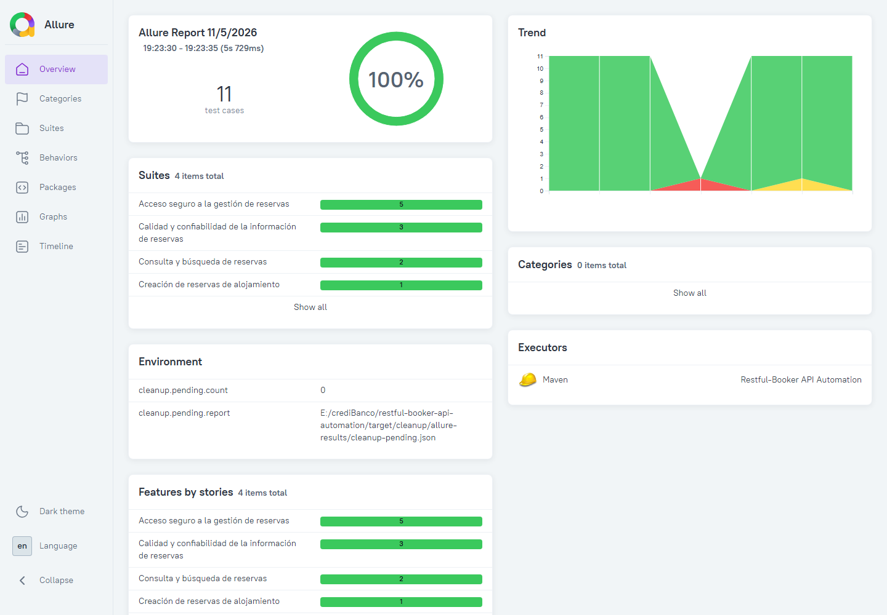
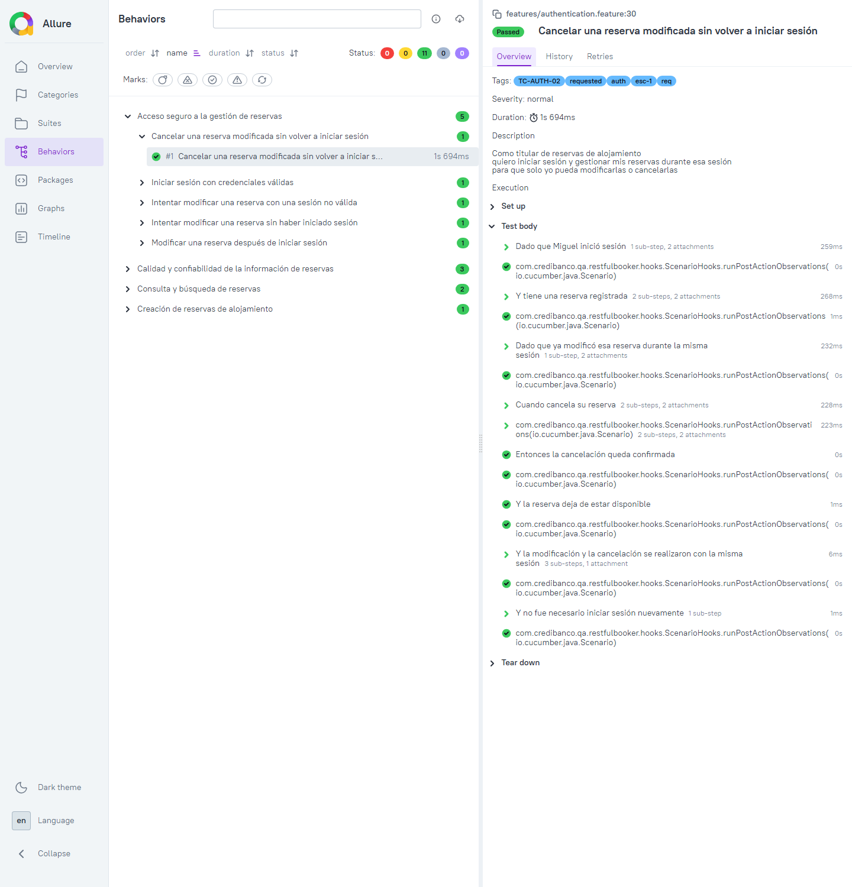
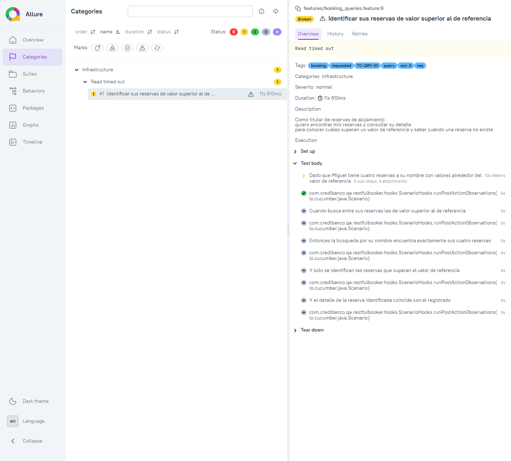

# Evidencias de ejecución

**Ejecución real · 2026-11-05 (UTC-5)** · Rama `fix/phase-1-false-positives` · API pública `https://restful-booker.herokuapp.com` · ambiente `qa`.

> La sección 2 se actualizó con una nueva ejecución real del mismo día, hecha después de dos ajustes: el token de `POST /auth` se obtiene deserializando a `AuthResponse`, y el SLA se valida con `time(lessThan(...))` de Rest Assured. Después se agregó la regla de nombres C-5 a `ArchitectureRulesTest` (105 → 106 tests). Las capturas de Allure y la tabla por escenario (§3) son de la ejecución de las 19:23; en la nueva ejecución los 11 escenarios volvieron a pasar, y el fallo forzado de la §6 siguió fallando con el prefijo `SLA:` (`took 259 ms; required < 1 ms`).

## 1. Entorno

| Elemento | Valor |
|---|---|
| SO | Windows 10 Home 10.0.19045 |
| JDK | Eclipse Temurin **21.0.13** (`JAVA_HOME` apuntando a `jdk-21.0.13.9-hotspot`) |
| Maven | 3.9.14 (`mvn` instalado y Maven Wrapper, la misma versión) |
| Credenciales | `RB_USERNAME` / `RB_PASSWORD` como variables de entorno del usuario; no se escriben en archivos ni en la consola |
| Enforcer | `RequireJavaVersion`, `RequireMavenVersion` y `DependencyConvergence`: **passed** |

> Con el JDK 17 del `PATH` el build se detiene en el Enforcer, como está previsto. Por eso todas las ejecuciones usan el JDK 21.

## 2. Comandos solicitados

| # | Comando | Resultado | Duración |
|---|---|---|---|
| 1 | `mvn clean test -Denv=qa` | ✅ `Tests run: 106, Failures: 0, Errors: 0, Skipped: 0` · **BUILD SUCCESS** | 24.8 s |
| 2 | `mvn test -Dtest=BookingCreationTests -Denv=qa` | ✅ `Running …runners.BookingCreationTests` · `Tests run: 1, Failures: 0, Errors: 0, Skipped: 0` · **BUILD SUCCESS** | 10.6 s |
| 3 | `mvn allure:serve` | ✅ `Local preview server started at <http://127.0.0.1:64494>` | — |
| — | `mvn allure:report` | ✅ `Report successfully generated to …\target\site\allure-maven-plugin` | — |
| — | `./mvnw clean verify -Denv=qa` | ✅ `Tests run: 106, Failures: 0, Errors: 0, Skipped: 0` · **BUILD SUCCESS** | 26.2 s |
| — | `mvn clean test -Pknown-defects -Denv=qa` | ✅ BUILD SUCCESS · `Tests run: 11, Skipped: 11`: no hay escenarios `@known-defect` implementados | 17.0 s |

Desglose del comando 1: **95 tests técnicos** de JUnit 5 y **11 escenarios** de Cucumber (`ApiScenariosSuite`).

| Clase técnica | Tests | | Clase técnica | Tests |
|---|---|---|---|---|
| FW-01 Sensitive data masking | 7 | | Screenplay actor | 16 |
| FW-02 Configuration resolution | 10 | | Model serialization | 13 |
| Architecture rules | 10 | | Booking data factory | 8 |
| Feature conventions | 6 | | Spec factory | 4 |
| HTTP Questions: not found vs. unexpected | 9 | | Tasks as preconditions | 5 |
| Then steps on incomplete evidence | 7 | | **Total** | **95** |

## 3. Resultado por escenario (Allure, ejecución final 19:23)

Reporte: **11 total · 11 passed · 0 failed · 0 broken · 0 skipped** (100 %). Sin categorías de defecto. Panel Environment: `cleanup.pending.count=0`, es decir, todas las reservas creadas se borraron.

| Esc. | Caso | Escenario | Estado | Duración |
|---|---|---|---|---|
| 1 | TC-AUTH-01 | Iniciar sesión con credenciales válidas | ✅ passed | 0.25 s |
| 1 | TC-AUTH-02 | Modificar una reserva después de iniciar sesión | ✅ passed | 1.68 s |
| 1 | TC-AUTH-02 | Cancelar una reserva modificada sin volver a iniciar sesión | ✅ passed | 1.69 s |
| 2 | TC-CRE-01 | Realizar una reserva de alojamiento | ✅ passed | 1.39 s |
| 3 | TC-QRY-01 | Identificar sus reservas de valor superior al de referencia | ✅ passed | 4.78 s |
| 4 | TC-CON-01 | Recibir la información completa de una reserva | ✅ passed | 1.73 s |
| 4 | TC-CON-02 | Consultar una reserva en un tiempo aceptable | ✅ passed | 1.26 s |
| 4 | TC-CON-03 | Recibir la información en el formato acordado | ✅ passed | 1.61 s |
| 5 | TC-NEG-01 | Intentar modificar una reserva sin haber iniciado sesión | ✅ passed | 1.75 s |
| 5 | TC-NEG-02 | Intentar modificar una reserva con una sesión no válida | ✅ passed | 2.05 s |
| 5 | TC-NEG-03 | Consultar una reserva inexistente | ✅ passed | 0.92 s |

Las duraciones son del escenario completo, con su preparación y su limpieza; se ejecutan en paralelo con 4 hilos. El SLA de TC-CON-02 se mide aparte, sobre un único `GET /booking/{id}`.

## 4. Reporte Allure (capturas del reporte real)

**Vista general:** 11 casos y 100 % aprobados. Debajo se ven las suites por funcionalidad y el panel *Environment* con la limpieza.



> El gráfico *Trend* reúne las ejecuciones locales de ese día, que Allure guarda en `.allure/history`. Las caídas que se ven corresponden al fallo forzado del SLA (rojo, §6) y a la incidencia de infraestructura (amarillo, §7). No son fallos de la ejecución final.

**Detalle de un escenario (TC-AUTH-02, cancelación):** etiquetas `@TC-AUTH-02`, `@esc-1` y `@req`, y la historia de usuario como descripción. Los pasos Gherkin muestran sus sub-pasos Screenplay y los adjuntos (request y response enmascarados). La observación posterior aparece justo después del `Cuando`, y la limpieza en *Tear down*.



**Clasificación de un fallo real** (ejecución con incidencia, §7): el *timeout* de la API llega a la categoría **Infrastructure**, como *broken*. El paso que falló es el `Dado` de preparación, y los demás pasos quedan omitidos.



## 5. Seguridad de las evidencias

| Revisión | Resultado |
|---|---|
| Valor de la contraseña en los logs de Maven (todas las ejecuciones) | 0 apariciones |
| Valor de la contraseña en `target/allure-results`, `target/site`, `target/surefire-reports` | 0 archivos |
| Tokens en los adjuntos de Allure | Todos como `"token":"***"` |
| Credenciales en el repositorio y en las capturas | Ninguna: solo `${RB_USERNAME}` / `${RB_PASSWORD}` |

## 6. Reporte de errores (fallo forzado)

Comprueba que un fallo real deja la ejecución en rojo y llega clasificado al reporte:

```text
mvn clean test -Denv=qa -Dtest=ApiScenariosSuite "-Dcucumber.filter.tags=@TC-CON-02" -Dsla.booking.get.ms=1

java.lang.AssertionError: SLA: GET /booking/{id} took 241 ms; required < 1 ms
[ERROR] Tests run: 11, Failures: 1, Errors: 0, Skipped: 10
[INFO] BUILD FAILURE                                   → exit code 1
```

| Señal | Resultado |
|---|---|
| Exit code de Maven | `1` |
| Resumen (`test-summary.sh`) | `❌ failed · TC-CON-02 esc-4 · Consultar una reserva en un tiempo aceptable · SLA: GET /booking/{id} took 241 ms; required < 1 ms` |
| Categoría Allure | `Performance (SLA)`: 1 failed |

## 7. Incidencia observada: timeout de la API pública

En una de las ejecuciones completas (`mvn clean test -Denv=qa`, 19:20), la API pública se degradó:

| Hecho | Detalle |
|---|---|
| Resultado | `Tests run: 104, Failures: 0, Errors: 1` · BUILD FAILURE. En Allure: 10 passed y 1 broken |
| Escenario afectado | TC-QRY-01: al crear la 3.ª de sus 4 reservas, en la preparación (`Dado`), la API no respondió dentro de `http.timeout.ms` (10 s) → `java.net.SocketTimeoutException: Read timed out` |
| Clasificación | **Infrastructure** (*broken*), no Product Defect: es correcto, porque el fallo no es de la funcionalidad bajo prueba |
| Limpieza | Una reserva de otro escenario (TC-NEG-02, que pasó) quedó pendiente porque su `DELETE` respondió **403**. Se vio en el paso *Data cleanup pending* (*Tear down*), en `cleanup-pending.json` y en `cleanup.pending.count=1`, como define D-08. Después, `GET /booking/5057` devolvió 404, así que no quedaron datos residuales en la API |
| Causa del 403 | **No determinada.** Coincidió con la degradación de la API y no se repitió en las demás ejecuciones. No se modifica el framework por una sola observación |
| Acción | Ninguna: no hay reintentos, por diseño (D-11, estrategia §5). La ejecución se repitió completa y dio 104/104 (§3) |

Así es como la estrategia prevé que se reporte una caída del entorno: el fallo queda visible y clasificado, sin enmascararlo como éxito ni como defecto del producto.

## 8. Dónde están las evidencias

| Evidencia | Ruta |
|---|---|
| Capturas del reporte Allure | `docs/delivery/evidence/*.png` (versionadas) |
| Resultados Allure | `target/allure-results/` (no versionado; se regenera con el comando 1) |
| Reporte HTML | `target/site/allure-maven-plugin/index.html` (`mvn allure:report`; para verlo, `mvn allure:serve`) |
| Reportes JUnit | `target/surefire-reports/` |
| Limpieza de datos | `target/cleanup/allure-results/cleanup-pending.json` (`[ ]` en la ejecución final) |
| Resumen por escenario | `bash .github/scripts/test-summary.sh "Main job" target/surefire-reports target/allure-results` |

## 9. Integración continua

Ningún requisito de la prueba exige ejecutar CI (ver [`ci-pipeline.md`](ci-pipeline.md) §6). El workflow queda **preparado pero sin activar**. Su único run en GitHub (al hacer push de la rama) se detuvo, como estaba previsto, en *Verify required secrets*, porque el repositorio no tiene `RB_USERNAME` ni `RB_PASSWORD`. No se agregan secretos: toda la evidencia de esta entrega es de la ejecución local.
